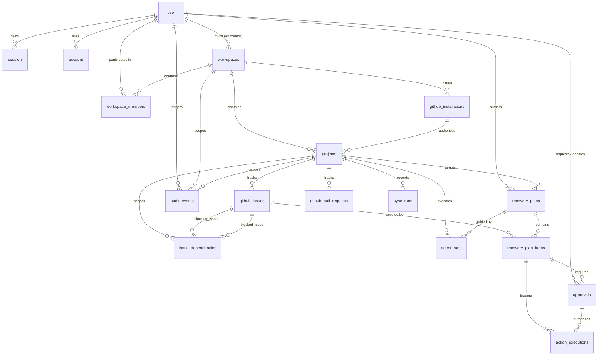

# ProjectRescue Data Modeling & Database Architecture Implementation

This document provides a comprehensive, architectural, and explanatory record of the data modeling, schema design, relations, validation, and repository layer implemented for **ProjectRescue**.

---

## 1. Architectural Overview & Hybrid Database Design

ProjectRescue is an agentic project-recovery platform that integrates with GitHub to provide AI-powered blocker detection, recovery planning, approval workflows, and controlled execution of remediation actions (also accessible via an MCP server for an Alexa+ hackathon experience).

To meet both strict relational integrity requirements and high-throughput, unstructured agent trace requirements, the platform utilizes a **hybrid database architecture**:

```
┌───────────────────────────────────────────────────────────────────────────┐
│                           ProjectRescue Platform                          │
└─────────────────────┬───────────────────────────────┬─────────────────────┘
                      │                               │
        Canonical Relational Data           Flexible Unstructured Data
                      │                               │
                      ▼                               ▼
       ┌──────────────────────────────┐ ┌──────────────────────────────┐
       │     PostgreSQL + Drizzle     │ │      MongoDB + Mongoose      │
       ├──────────────────────────────┤ ├──────────────────────────────┤
       │ • Better Auth & Sessions     │ │ • Full GitHub Tree Snapshots │
       │ • Workspaces & Memberships   │ │ • Agent Diagnostic Artifacts │
       │ • GitHub Repos, Issues & PRs │ │ • Tool Call Traces           │
       │ • Issue Dependency Edges     │ │ • Raw Webhook Payloads       │
       │ • Recovery Plans & Steps     │ │                              │
       │ • Approvals & Executions     │ │                              │
       │ • Audit Events & Delivery IDs│ │                              │
       └──────────────────────────────┘ └──────────────────────────────┘
```

### Database Ownership Matrix

| Entity | Canonical Store | Why this store? | Cross-Database Link |
|---|---|---|---|
| **Users, Sessions, Accounts** | PostgreSQL (Drizzle) | Better Auth compatibility, session lookup speed, relational foreign keys. | Canonical ID: `user.id` (`text`) |
| **Workspaces & Members** | PostgreSQL (Drizzle) | Multi-tenant isolation, role-based authorization, ACID workspace boundary. | `workspaces.id` (`uuid`) |
| **GitHub Installations & Projects** | PostgreSQL (Drizzle) | Relational mapping to GitHub repos, optimistic concurrency versioning. | `projects.id` (`uuid`) |
| **GitHub Issues & Pull Requests** | PostgreSQL (Drizzle) | Fast filtering by project, status, and blocker count; strict uniqueness. | `githubIssues.id` (`uuid`) |
| **Issue Dependency Edges** | PostgreSQL (Drizzle) | Graph traversal, blocker cycle prevention, foreign-key cascaded deletes. | `issueDependencies.id` (`uuid`) |
| **Sync Runs** | PostgreSQL (Drizzle) | Audit trail of sync operations; references point-in-time MongoDB snapshots. | Stores MongoDB `_id` in `snapshotReference` |
| **Recovery Plans & Plan Items** | PostgreSQL (Drizzle) | Versioned recovery proposals, ordered execution steps, approval states. | `recoveryPlans.id`, `recoveryPlanItems.id` |
| **Approvals & Action Executions** | PostgreSQL (Drizzle) | Two-phase approval gatekeeping, strict idempotency enforcement. | `approvals.id`, `actionExecutions.id` |
| **Agent Runs & Audit Events** | PostgreSQL (Drizzle) | System compliance audit trail, user activity timeline. | Stores MongoDB `_id`s in `mongoArtifactIds` |
| **GitHub Delivery Events** | PostgreSQL (Drizzle) | Authoritative, synchronous webhook deduplication via `deliveryId` unique key. | `githubDeliveryEvents.id` (`uuid`) |
| **GitHub Snapshots** | MongoDB (Mongoose) | Arbitrarily deep/nested GitHub issue/PR hierarchies without relational schema bloat. | Stores PostgreSQL `workspaceId`, `projectId`, `syncRunId` |
| **Agent Artifacts** | MongoDB (Mongoose) | Tool execution outputs, LLM context summaries, evaluations, dynamic diagnostics. | Stores PostgreSQL `workspaceId`, `projectId`, `agentRunId` |
| **Webhook Payload Archives** | MongoDB (Mongoose) | Raw, unparsed/sanitized JSON payloads for replay and deep debugging. | Stores GitHub `deliveryId` string |

### Cross-Database Consistency Model
- **No Distributed Transactions**: PostgreSQL and MongoDB are treated as independent databases. Distributed two-phase commit is avoided.
- **PostgreSQL as Source of Truth**: All business decisions, permissions, approval gates, and state machines live strictly in PostgreSQL.
- **Monotonic References**: MongoDB documents store PostgreSQL UUIDs as simple indexed string fields (`workspaceId`, `projectId`, `agentRunId`). If a MongoDB write fails during an agent run or sync run, the PostgreSQL canonical record still records the failure state cleanly.

---

## 2. PostgreSQL Relational ER Model (Drizzle ORM)

### Visual Entity Relationship Diagram



---

## 3. Modular Drizzle Schemas Deep Dive

All tables are implemented in dedicated modular files under `src/db/schema/` according to the conventions in `docs/rules.md`.

### 3.1 Authentication (`src/db/schema/auth-schema.ts`)
Compatible with Better Auth and `better-auth/adapters/drizzle`:
- **`user`**: `id` (`text` PK), `name`, `email` (`unique`), `emailVerified`, `image`, `role`, `banned`, `banReason`, `banExpires`, timestamps.
- **`session`**: `id` (`text` PK), `expiresAt`, `token` (`unique`), `ipAddress`, `userAgent`, `userId` (`references user.id ON DELETE CASCADE`), `impersonatedBy`.
- **`account`**: `id` (`text` PK), `accountId`, `providerId`, `userId` (`references user.id ON DELETE CASCADE`), OAuth token fields, hashed password, timestamps.
- **`verification`**: `id` (`text` PK), `identifier`, `value`, `expiresAt`, timestamps.

### 3.2 Workspaces & Memberships
- **`workspaces`** (`src/db/schema/workspace.schema.ts`):
  - `id`: `uuid` PK with `defaultRandom()`
  - `name`: `varchar(255)` NOT NULL
  - `slug`: `varchar(255)` NOT NULL UNIQUE
  - `ownerId`: `text` NOT NULL, `references user.id ON DELETE RESTRICT` (prevents deleting a user that still owns active organizations)
  - `metadata`: `jsonb` with TypeScript typing
  - Timestamps with timezone (`withTimezone: true`)
  - Indexes: `workspace_owner_id_idx`, `workspace_slug_idx`
- **`workspace_members`** (`src/db/schema/workspace-member.schema.ts`):
  - `workspaceId`: `uuid` references `workspaces.id ON DELETE CASCADE`
  - `userId`: `text` references `user.id ON DELETE CASCADE`
  - `role`: `varchar(50)` default `'member'` (`'owner' | 'admin' | 'member' | 'viewer'`)
  - Unique Constraint: `(workspaceId, userId)` ensures a user cannot have duplicate memberships in the same workspace.

### 3.3 GitHub Integration & Projects
- **`github_installations`** (`src/db/schema/github-installation.schema.ts`):
  - `installationId`: `bigint` NOT NULL UNIQUE (GitHub's App Installation ID)
  - `workspaceId`: `uuid` references `workspaces.id ON DELETE CASCADE`
  - `accountLogin`: `varchar(255)` (org or username)
  - `accountType`: `'User' | 'Organization'`
  - `encryptedToken`: `text` for secure GitHub App token handling
  - `status`: `'active' | 'suspended' | 'deleted'`
- **`projects`** (`src/db/schema/project.schema.ts`):
  - `workspaceId`: `uuid` references `workspaces.id ON DELETE CASCADE`
  - `githubInstallationId`: `uuid` references `github_installations.id ON DELETE SET NULL`
  - `name`, `repoOwner`, `repoName`, `githubRepoId` (`bigint`)
  - `defaultBranch`: `varchar(100)` default `'main'`
  - `healthScore`: `integer` (0-100 score calculated by blocker analysis)
  - `version`: `integer` default `1` for **Optimistic Concurrency Control**
  - Unique Constraint: `(workspaceId, repoOwner, repoName)` prevents duplicate repository attachments per workspace.

### 3.4 GitHub Issues, Pull Requests & Dependencies
- **`github_issues`** (`src/db/schema/github-issue.schema.ts`):
  - `projectId`: references `projects.id ON DELETE CASCADE`
  - `githubIssueId`: `bigint` NOT NULL UNIQUE (Global GitHub node/id)
  - `issueNumber`: `integer` NOT NULL
  - `title`, `body`, `state` (`'open' | 'closed'`), `stateReason`
  - `assignees`, `labels`: `jsonb` arrays
  - `isBlocked`: `boolean` default `false` (fast lookup flag)
  - `blockerCount`: `integer` default `0`
  - `criticality`: `'low' | 'medium' | 'high' | 'critical'`
  - Unique Constraint: `(projectId, issueNumber)` handles issue numbering per repo.
- **`github_pull_requests`** (`src/db/schema/github-pull-request.schema.ts`):
  - `projectId`: references `projects.id ON DELETE CASCADE`
  - `githubPrId`: `bigint` NOT NULL UNIQUE
  - `prNumber`: `integer` NOT NULL
  - `state` (`'open' | 'closed' | 'merged'`), `isDraft`, `headRef`, `baseRef`
  - Unique Constraint: `(projectId, prNumber)`
- **`issue_dependencies`** (`src/db/schema/issue-dependency.schema.ts`):
  - `projectId`: references `projects.id ON DELETE CASCADE`
  - `blockingIssueId`: references `github_issues.id ON DELETE CASCADE`
  - `blockedIssueId`: references `github_issues.id ON DELETE CASCADE`
  - `dependencyType`: `'blocks' | 'relates_to' | 'parent_child'`
  - `discoveredBy`: `'ai_agent' | 'manual' | 'github_link'`
  - `confidence`: `integer` (0-100 AI detection confidence)
  - Unique Constraint: `(blockingIssueId, blockedIssueId)` prevents duplicate edges.
- **`sync_runs`** (`src/db/schema/sync-run.schema.ts`):
  - `projectId`: references `projects.id ON DELETE CASCADE`
  - `trigger`: `'manual' | 'webhook' | 'scheduled' | 'agent'`
  - `status`: `'pending' | 'running' | 'completed' | 'failed'`
  - `issuesSynced`, `prsSynced`, `dependenciesDetected`
  - `snapshotReference`: `text` storing MongoDB `GitHubSnapshot._id`

### 3.5 Recovery Planning, Approvals & Action Executions
- **`recovery_plans`** (`src/db/schema/recovery-plan.schema.ts`):
  - `projectId`: references `projects.id ON DELETE CASCADE`
  - `createdById`: references `user.id ON DELETE SET NULL`
  - `title`, `description`, `riskLevel`
  - `version`: `integer` default `1`
  - `status`: `'draft' | 'proposed' | 'in_progress' | 'completed' | 'rejected' | 'superseded'`
  - `assumptions`: `jsonb`
  - Unique Constraint: `(projectId, version)` enforces strict plan version history.
- **`recovery_plan_items`** (`src/db/schema/recovery-plan-item.schema.ts`):
  - `planId`: references `recovery_plans.id ON DELETE CASCADE`
  - `issueId`: references `github_issues.id ON DELETE SET NULL`
  - `orderIndex`: `integer` NOT NULL (execution sequence)
  - `actionType`: `'reassign' | 'add_comment' | 'close_issue' | 'update_labels' | 'split_task' | 'create_pr' | 'escalate'`
  - `actionPayload`: `jsonb` containing structured parameter values
  - `status`: `'pending' | 'approved' | 'rejected' | 'in_progress' | 'completed' | 'failed' | 'skipped'`
  - `requiresApproval`: `boolean` default `true`
- **`approvals`** (`src/db/schema/approval.schema.ts`):
  - `planItemId`: references `recovery_plan_items.id ON DELETE CASCADE`
  - `requestedById`: references `user.id ON DELETE SET NULL`
  - `decisionById`: references `user.id ON DELETE SET NULL`
  - `status`: `'pending' | 'approved' | 'rejected' | 'revoked'`
  - `decisionNote`: `text`
  - `requestedAt`, `decidedAt`
- **`action_executions`** (`src/db/schema/action-execution.schema.ts`):
  - `approvalId`: references `approvals.id ON DELETE SET NULL`
  - `planItemId`: references `recovery_plan_items.id ON DELETE CASCADE`
  - `idempotencyKey`: `varchar(255)` NOT NULL UNIQUE (guarantees safe retries without double action dispatch)
  - `status`: `'pending' | 'running' | 'succeeded' | 'failed' | 'retrying'`
  - `executedBy`: `'system' | 'agent' | 'manual'`
  - `attempts`: `integer` default `0`
  - `executionPayload`, `result`: `jsonb`

### 3.6 Agent Runs, Audit Events & Webhook Deduplication
- **`agent_runs`** (`src/db/schema/agent-run.schema.ts`):
  - `projectId`: references `projects.id ON DELETE CASCADE`
  - `planId`: references `recovery_plans.id ON DELETE SET NULL`
  - `trigger`: `'scheduled' | 'manual' | 'sync_completed' | 'mcp_tool' | 'alexa'`
  - `status`: `'running' | 'completed' | 'failed' | 'cancelled'`
  - `prompt`, `model`, `tokensUsed`, `summary`
  - `mongoArtifactIds`: `jsonb` string array referencing MongoDB `AgentArtifact._id`
- **`audit_events`** (`src/db/schema/audit-event.schema.ts`):
  - `workspaceId`: references `workspaces.id ON DELETE CASCADE`
  - `projectId`: references `projects.id ON DELETE SET NULL`
  - `userId`: references `user.id ON DELETE SET NULL`
  - `action`: e.g. `'project.connected'`, `'plan.created'`, `'plan_item.approved'`
  - `entityType`, `entityId`, `details`, `ipAddress`
- **`github_delivery_events`** (`src/db/schema/github-delivery-event.schema.ts`):
  - `deliveryId`: `varchar(255)` NOT NULL UNIQUE (matches `X-GitHub-Delivery` HTTP header)
  - `eventType`: `varchar(100)`
  - `status`: `'received' | 'processing' | 'completed' | 'failed' | 'ignored'`
  - Ensures exactly-once webhook processing semantics in PostgreSQL.

---

## 4. MongoDB / Mongoose Document Layer

Following `docs/rules.md`, all Mongoose interfaces are declared in `src/types/` and models are declared in `src/models/` with duplicate model prevention for Next.js hot module replacement.

### 4.1 Document Interfaces (`src/types/`)
- **`github-snapshot.type.ts`**:
  - `IGitHubSnapshot`: contains project and sync identifiers, version metadata, and typed arrays of `ISnapshotIssue` and `ISnapshotPullRequest`.
- **`agent-artifact.type.ts`**:
  - `IAgentArtifact`: captures agent diagnostics for `artifactType` in `['context_summary', 'tool_trace', 'evaluation', 'error_report']`.
- **`webhook-payload-archive.type.ts`**:
  - `IWebhookPayloadArchive`: archives raw payloads with `deliveryId`, `eventType`, `payload`, and `processingStatus`.

### 4.2 Mongoose Models (`src/models/`)
- **`GitHubSnapshot`** (`src/models/github-snapshot.model.ts`):
  - Uses nested typed sub-schemas (`snapshotIssueSchema`, `snapshotPullRequestSchema`) with `{ _id: false }` to prevent unnecessary subdocument ID generation.
  - Compound indexes: `{ projectId: 1, capturedAt: -1 }`, `{ projectId: 1, sourceVersion: 1 }`, and `{ syncRunId: 1 }`.
- **`AgentArtifact`** (`src/models/agent-artifact.model.ts`):
  - Indexes: `{ projectId: 1, createdAt: -1 }` and `{ agentRunId: 1, artifactType: 1 }`.
- **`WebhookPayloadArchive`** (`src/models/webhook-payload-archive.model.ts`):
  - Unique index on `deliveryId`.
  - Compound index on `{ eventType: 1, receivedAt: -1 }`.

### 4.3 Connection Pooling & Hot Reload (`src/lib/mongodb.ts`)
Implements global promise caching (`global.mongooseConnection`) to prevent connection exhaustion in serverless Next.js route handlers and Turbopack dev server hot reloads.

---

## 5. Zod Request Validation Layer (`src/validation/`)

API boundaries are protected by dedicated Zod schemas that validate inputs before hitting services or repositories:
- **`workspace.validation.schema.ts`**: Validates slug format (`/^[a-z0-9-]+$/`), workspace names, and member role assignments.
- **`project.validation.schema.ts`**: Validates repository connections and enforces `version` checks on updates for optimistic locking.
- **`recovery-plan.validation.schema.ts`**: Validates plan creation, risk levels, and action item definitions (`reassign`, `add_comment`, etc.).
- **`approval.validation.schema.ts`**: Validates approval requests and decisions (`'approved' | 'rejected'`) with optional notes.
- **`action-execution.validation.schema.ts`**: Validates execution trigger requests and enforces non-empty `idempotencyKey` strings.

---

## 6. Repository Pattern Implementations (`src/repositories/`)

Data persistence is abstracted into type-safe repositories that enforce business invariants:

1. **`workspaceRepository`**:
   - Creates workspaces and automatically registers the creator in `workspace_members` with the `'owner'` role.
   - Enforces workspace lookup by ID, unique slug, and user memberships.
2. **`projectRepository`**:
   - Connects GitHub projects with initial concurrency `version = 1`.
   - `updateWithVersion(projectId, expectedVersion, updates)`: executes an atomic SQL UPDATE with `WHERE id = $1 AND version = $2`, incrementing version to `$2 + 1`. Throws a concurrency error if another process modified the project concurrently.
3. **`githubIssueRepository`**:
   - `upsertIssue()`: Uses PostgreSQL `onConflictDoUpdate` targeting `githubIssueId` for idempotent synchronization.
   - `addDependency()`: Validates that both `blockingIssueId` and `blockedIssueId` belong to the **same project**, and automatically toggles `isBlocked = true` on the target issue.
4. **`recoveryPlanRepository`**:
   - Queries the highest current `version` for the project and automatically provisions `nextVersion = latest + 1`.
   - Inserts the recovery plan and its associated plan items.
5. **`approvalRepository`**:
   - Handles the approval lifecycle (`pending` -> `approved`/`rejected`).
   - Automatically synchronizes the corresponding `recovery_plan_items.status` when a decision is recorded.
6. **`actionExecutionRepository`**:
   - Checks `actionExecutions.idempotencyKey` first. If an execution with that key already exists, returns the existing record immediately (`isDuplicate: true`).
   - If an `approvalId` is linked, verifies that the approval has `status === 'approved'` before permitting execution to start.
   - Transitions plan item states to `in_progress`, `completed`, or `failed`.

---

## 7. Migration & Drizzle Kit Configuration

### Configuration (`drizzle.config.ts`)
```ts
import 'dotenv/config';
import { defineConfig } from 'drizzle-kit';

export default defineConfig({
  out: './drizzle',
  schema: './src/db/schema/index.ts',
  dialect: 'postgresql',
  dbCredentials: {
    url: process.env.DATABASE_URL!,
  },
});
```

### Initial Generated Migration
- Migration generated at: `drizzle/20261011054110_romantic_magik/migration.sql`
- Contains:
  - 16 PostgreSQL tables
  - 29 B-tree indexes & unique indexes
  - 18 Foreign-key constraints with explicit cascade rules
- Verified with TypeScript: `bun x tsc --noEmit` passed with **0 errors**.

### Available Database Commands
```bash
# Generate SQL migration from schema changes
bun run db:generate

# Execute pending migrations against target database
bun run db:migrate

# Push schema directly to database (development prototype mode)
bun run db:push

# Open web-based Drizzle Studio interface
bun run db:studio
```

---

## 8. Git Commit Log & History

The implementation was committed and pushed to `origin/main` in 5 distinct, feature-segregated commits:

| Commit Hash | Commit Type & Scope | Description |
|---|---|---|
| **`29847c0`** | `docs` | Add data modeling specifications and architecture rules (`datamodeling.md`, `rules.md`). |
| **`72bc5e7`** | `feat(db)` | Implement modular Drizzle schemas, relations, and initial SQL migration. |
| **`f8315ce`** | `feat(mongodb)` | Add Mongoose models, TypeScript interfaces, and Next.js cached connection. |
| **`67e1cb2`** | `feat(validation)` | Add Zod request validation schemas for API inputs and outputs. |
| **`85f613f`** | `feat(repositories)` | Implement feature repositories with optimistic locking and idempotency. |
